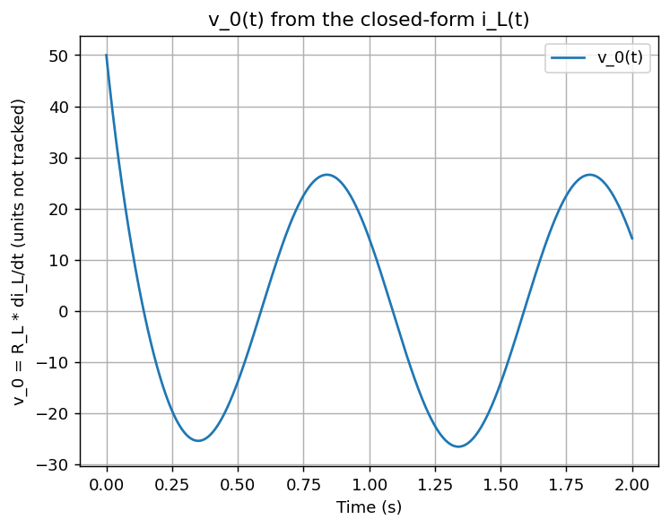

# Symbolic Solution of a Driven Circuit Equation

**Timeline:** October 2024

This script uses SymPy to solve the first-order differential equation for the inductor current i_L(t) of a circuit driven by a sinusoidal source V_s = A cos(ωt). It differentiates the solution, multiplies by R_L to get v_0(t) = R_L · di_L/dt, simplifies the result symbolically, and plots it for one set of component values.



*v_0(t) = R_L · di_L/dt from 0 to 2 s. It starts at 50 and settles into a 1 Hz sine wave of about 26.6 amplitude within roughly half a second. The script does not track units.*

## What the plotted quantity is

The script plots R_L · di_L/dt exactly as it was defined in the original coursework submission. With R_L in ohms and i_L in amperes this quantity has dimensions of volts per second, so it is not dimensionally a voltage, and the plot labels no longer call it one.

The equation `V_s - Rs*i_L - N*di_L/dt = 0` balances in volts only if N is an inductance in henries. The script scales the derivative term by N. The symbol L (value 0.1) is declared and substituted into the result but does not appear in it. Using L in place of N would change the time constant and every plotted value.

## How it works

- The circuit equation is `V_s - Rs*i_L - N*di_L/dt = 0` with `V_s = A*cos(ω*t)` and the initial condition `i_L(0) = 0`. `sympy.dsolve` returns i_L(t) in closed form. The equation has a resistance term and one derivative term and no capacitor term, so it is first order.
- i_L(t) is differentiated symbolically, multiplied by R_L, and passed through `sympy.simplify`. The script prints the result, which is equivalent to v_0(t) = A·R_L·[N·ω·(N·ω·cos ωt - R_s·sin ωt) + R_s²·e^(-R_s·t/N)] / [N·(N²ω² + R_s²)]. The first part is a steady sinusoid and the second part is a transient that decays with time constant N/R_s. The printed form writes ω as `omega`.
- Numerical values: A = 1.0, ω = 2π rad/s, R_s = 10, R_L = 50, N = 1.0. The transient time constant is 0.1 s, v_0(0) = A·R_L/N = 50, and the steady sinusoid has frequency 1 Hz and amplitude A·R_L·ω / √(N²ω² + R_s²) = 26.60. The transient falls below 1% of that amplitude after about 0.49 s.
- The closed form is turned into a NumPy function with `sympy.lambdify` and evaluated at 1000 points from t = 0 to t = 2 s.

## Run it

```
python -m venv .venv
source .venv/bin/activate    # Windows: .venv\Scripts\activate
pip install -r requirements.txt
python circuit_ode.py
```

The script saves the plot to `figures/v0-plot.png` at 130 dpi, opens the plot window, and after the window is closed prints the closed-form v_0(t).

Tested with Python 3.11.5, numpy 1.26.4, sympy 1.13.2 and matplotlib 3.9.2 on Windows. `requirements.txt` sets the minimum versions to the ones listed here.

## Changes from the original submission

The equation, component values and computation are unchanged. Four edits were made:

- The SymPy symbol for ω is named `omega`, so printing the result works on Windows when standard output is redirected and uses a non-UTF-8 encoding.
- The plot title, the y-axis label and the print label no longer say "Voltage" or "Problem 4.4".
- The script saves the plot to `figures/v0-plot.png` (130 dpi, tight bounding box) before showing it. The original only displayed the window.
- The committed figure was re-rendered from this script with the new labels.

## Background

Coursework project, problem 4.4 in Rico Picone's Engineering Computing textbook. The exercise statement is not reproduced here.

## License

No license file is included, so no permission to copy or reuse the code is granted.
